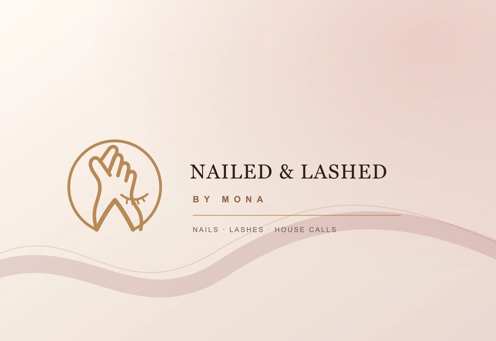

<p align="center">
  
</p>

<p align="center">
  <a href="https://solarspin-namibia.pages.dev/"></a>
  <a href="https://freeman-ipumbu.pages.dev/"></a>
  <a href="https://github.com/freeman-ipumbu/fuel-retail-digital-platform-case-study"></a>
</p>

## We build systems that hold.

SolarSpin Technologies is a Namibia-born technology and product company founded by [Freeman Ipumbu](https://github.com/freeman-ipumbu).

We work where the interface meets the operating reality underneath it. Product strategy, system architecture, infrastructure, access, recovery, evidence, privacy, support and handover all belong to the same system.

```text
UNDERSTAND THE REAL CONDITIONS
          ↓
FRAME THE SYSTEM
          ↓
BUILD THE HARD PARTS
          ↓
TEST THE FAILURE EDGES
          ↓
SHIP WITH A HANDOVER
```

## What lives here

- **Products:** Namibia-first platforms built around real operating conditions.
- **Client experiences:** selected digital systems developed with explicit commercial and confidentiality boundaries.
- **Public case studies:** decision records that show the architecture without exposing private source, credentials or client-sensitive material.
- **Research:** design science translated into working tools, repeatable methods and better handovers.

Our wider body of work spans financial technology, mobility, emergency coordination, aviation, marine operations, agriculture, healthcare, education, beauty and service operations, local commerce, sport and music.

## Latest client launch: NAILED & Lashed by Mona

<p align="center">
  <a href="https://monaluxe.pages.dev/"></a>
</p>

A Windhoek beauty business now has one installable client and operations system: a real-work portfolio, transparent studio and house-call booking, secure return-client accounts, Mona Luxe Circle rewards and referrals, and a private StudioDesk for bookings, financial oversight, client value and loyalty. Dedicated enquiries support beginner training with or without a kit, advanced nail-art training and lash training by request, while the enhanced identity extends into a delivery-ready social brand kit.

Mona Luxe Circle awards 8 Gloss Points per N$1 of eligible service spend, with 300 welcome points, a 1,000-point referrer reward and 500-point friend reward after an eligible first visit. Glow, Luxe and Icon begin at 0, 5,000 and 15,000 lifetime points; the four launch rewards unlock at 2,500, 5,000, 9,000 and 14,000 available points. Travel fees do not earn points, and rewards have no cash value.

**[Enter Mona Luxe ↗](https://monaluxe.pages.dev/)** · **[Read the public case study ↗](https://github.com/freeman-ipumbu/monaluxe-case-study)**

## The public boundary

Public proof is not the same thing as a production claim. Repositories clearly distinguish research, prototypes, controlled pilots and live experiences. Private source, secrets and client-confidential material remain private.

## Start here

- [Experience SolarSpin](https://solarspin-namibia.pages.dev/)
- [Explore Freeman's full portfolio](https://freeman-ipumbu.pages.dev/)
- [Read the anonymous Fuel Retail Digital Platform case study](https://github.com/freeman-ipumbu/fuel-retail-digital-platform-case-study)
- [Inspect the published IT Handover Continuance research](https://doi.org/10.5281/zenodo.21840440)

<sub>Windhoek, Namibia. Founded November 2025.</sub>
