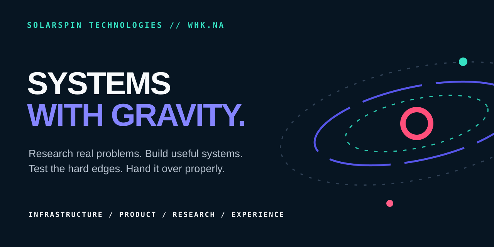

<p align="center">
  
</p>

<p align="center">
  <a href="https://www.solarspin-namibia.xyz/"></a>
  <a href="https://www.solarspin-namibia.xyz/#work"></a>
  <a href="https://github.com/freeman-ipumbu"></a>
</p>

## We build systems that hold.

SolarSpin Technologies is a Namibia-born technology and product company founded by [Freeman Ipumbu](https://github.com/freeman-ipumbu) in Windhoek.

We work where the interface meets the operating reality underneath it. Product strategy, system architecture, infrastructure, access, recovery, evidence, privacy, support and handover belong to the same system.

```text
UNDERSTAND THE REAL CONDITIONS
          ↓
FRAME THE SYSTEM
          ↓
BUILD THE HARD PARTS
          ↓
TEST THE FAILURE EDGES
          ↓
SHIP WITH A HANDOVER
```

<p align="center">
  <a href="https://www.solarspin-namibia.xyz/">
    
  </a>
</p>

## The live system

SolarSpin's digital headquarters is an experience, not a brochure:

- **Solar Day / Interstellar Night:** two complete atmospheres, initially aligned to Windhoek light and still under the visitor's control.
- **One engine, clear relationships:** an interactive map connects founder judgement, SolarSpin, owned ventures, commercial work, research and internal systems without blurring ownership.
- **30-system Public Atlas:** four interactive orbits present public proof with status, role, attribution and release boundaries attached.
- **The Gravity Table:** “What are you carrying?” becomes a six-stage, human-readable brief protected by Turnstile, validation, privacy-conscious rate limits, idempotent storage and a visible email fallback.
- **System Pulse:** the public health signal reports intake, archive, shield and courier state without exposing messages or secrets.
- **A cosmic close:** Milky Way → Solar System → Earth → Africa → Namibia → Windhoek, ending with “You've now had a SolarSpin Experience.”

**[Enter the SolarSpin Experience ↗](https://www.solarspin-namibia.xyz/)** · **[Read the public website build record ↗](https://github.com/freeman-ipumbu/solarspin-website-case-study)**

## The Public Atlas

| Orbit | Systems | What it proves |
| --- | ---: | --- |
| **Owned Universe** | 4 | Founder ventures and long-horizon product conviction |
| **Command + Operations** | 12 | Operational systems, coordination, evidence and technical leadership |
| **Digital Experiences** | 11 | Identity, service, commerce and client-facing product work |
| **Research + Build Records** | 3 | Published research, build evidence and transferable methods |

Current public signals include:

- [Ontoko Foods](https://github.com/freeman-ipumbu/ontoko-foods-case-study): live story, ordering, mapping and protected farm operations
- [TPTS Grid](https://github.com/freeman-ipumbu/tpts-grid-case-study): TPTS-owned Namibia travel network with a SolarSpin-built digital experience
- [JB.Braids](https://github.com/freeman-ipumbu/jb-braids-case-study): installable booking, Crown Club and private studio operations
- [NAILED & Lashed by Mona](https://github.com/freeman-ipumbu/monaluxe-case-study): booking, loyalty, training and StudioDesk
- [PDM Namibia](https://github.com/freeman-ipumbu/pdm-namibia-case-study): national civic and operations platform programme
- [IT Handover Continuance](https://doi.org/10.5281/zenodo.21840440): published Design Science Research on living operational knowledge

## Public proof. Private production.

The public repositories are case studies and decision records. They show the thinking, interaction evidence, architecture and honest limits of the work. Production source, credentials, deployment secrets, client records, protected commercial material and private analytics stay private.

The boundaries are specific, not ceremonial:

- client and partner ownership is named where it matters;
- controlled pilots are not described as production services;
- the fuel-retail prospect remains anonymous;
- TPTS work is attributed to technical leadership through TPTS Namibia where appropriate;
- screenshots exclude credentials, private records and customer information;
- the live SolarSpin site deploys from its private production repository, while the public website case study remains a presentation-safe build record.

## Start here

- **Carrying an untidy operation, a product idea, a live system or an identity that no longer fits?** [Put it on the Gravity Table](https://www.solarspin-namibia.xyz/#contact).
- **Want the full public proof?** [Open the 30-system Public Atlas](https://www.solarspin-namibia.xyz/#work).
- **Want the founder behind the system?** [Meet Freeman Ipumbu](https://freeman-ipumbu.pages.dev/).

<sub>Windhoek, Namibia · Founded November 2025 · The source is private. The thinking is visible. The standard is public.</sub>
